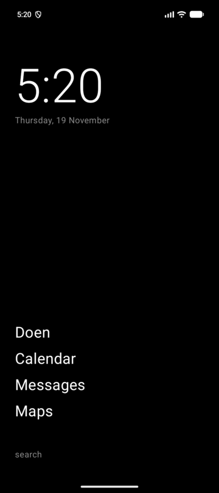
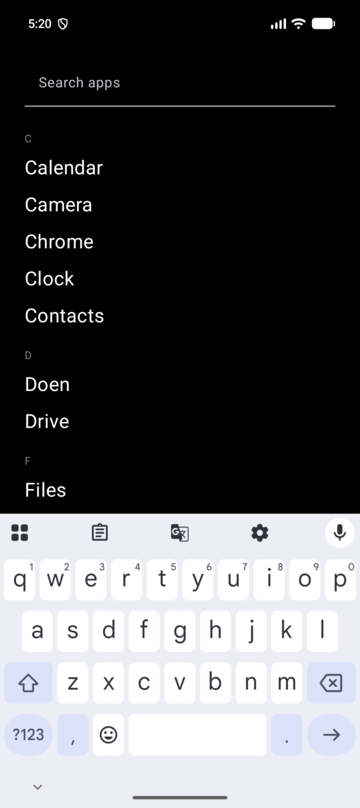
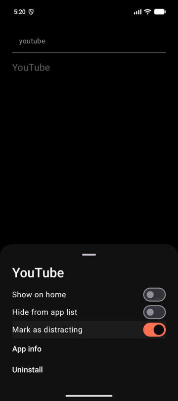
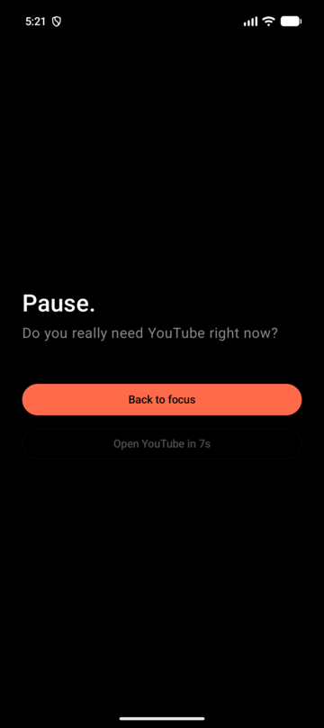

<h1 align="center">Focus Launcher</h1>

<p align="center">
  A text-only Android home screen that puts a pause between you and your distracting apps.
</p>

<p align="center">
  <a href="#install"><strong>Install</strong></a> ·
  <a href="docs/roadmap.md"><strong>Roadmap</strong></a> ·
  <a href="https://github.com/Paliy0/nu-launcher/issues"><strong>Issues</strong></a>
</p>

<p align="center">
  <a href="https://github.com/Paliy0/nu-launcher/releases/latest"><picture><source media="(prefers-color-scheme: dark)" srcset="https://shieldcn.dev/github/release/Paliy0/nu-launcher.svg?variant=ghost&amp;font=geist-mono&amp;mode=dark&amp;label=RELEASE&amp;logo=lu:Tag&amp;valueColor=60A5FA" /></picture></a>
  <a href="https://github.com/Paliy0/nu-launcher/releases"><picture><source media="(prefers-color-scheme: dark)" srcset="https://shieldcn.dev/github/downloads/Paliy0/nu-launcher.svg?variant=ghost&amp;font=geist-mono&amp;mode=dark&amp;label=DOWNLOADS&amp;logo=lu:CloudDownload&amp;valueColor=A78BFA" /></picture></a>
  <a href="https://github.com/Paliy0/nu-launcher/actions/workflows/ci.yml"><picture><source media="(prefers-color-scheme: dark)" srcset="https://shieldcn.dev/github/ci/Paliy0/nu-launcher.svg?variant=ghost&amp;font=geist-mono&amp;mode=dark&amp;workflow=ci.yml&amp;label=BUILD&amp;logo=lu:Hammer&amp;valueColor=4ADE80" /></picture></a>
  <br>
  <picture><source media="(prefers-color-scheme: dark)" srcset="https://shieldcn.dev/badge/ANDROID-10%2B.svg?variant=ghost&amp;font=geist-mono&amp;mode=dark&amp;logo=android&amp;valueColor=4ADE80" /></picture>
  <picture><source media="(prefers-color-scheme: dark)" srcset="https://shieldcn.dev/badge/KOTLIN-COMPOSE.svg?variant=ghost&amp;font=geist-mono&amp;mode=dark&amp;logo=kotlin&amp;valueColor=A78BFA" /></picture>
</p>

<p align="center">
  
  
  
  
</p>

No icons, no widgets, no feed. Your five everyday apps sit one tap from home; everything else is
two or three letters away in search. Apps you mark as distracting open behind a 10-second pause.

Built with Kotlin and Jetpack Compose. No tracking, no internet permission, nothing beyond AndroidX.

## Features

- **Home:** clock, date and up to five favorites. Swipe up or tap _search_ for everything else.
- **Search:** type a few letters and press Enter. Prefix matches rank first, then word starts
  (`maps` finds Google Maps), then anything containing the text. Accents are ignored.
- **Long-press any app:** show on home, hide from the list, mark as distracting, app info, uninstall.
  Hidden apps still turn up in search.
- **Pause screen:** distracting apps open behind a 10-second countdown with a big _Back to focus_ button.
- **Work profile** apps are listed and open as the right user.

What's next is in the [roadmap](docs/roadmap.md): usage minutes and daily limits on the pause
screen, then a Today panel with to-dos and habits.

## Install

On a phone with Android 10 or newer:

- **Obtainium:** add `https://github.com/Paliy0/nu-launcher` to get updates as they're released.
- **APK:** download `nu-launcher-*.apk` from [Releases](https://github.com/Paliy0/nu-launcher/releases)
  and open it.

Then make it your home app: Settings → Apps → Default apps → Home app → **Focus**. Your previous
launcher stays installed, so you can switch back the same way.

## Build

Needs JDK 17 and the Android SDK.

```sh
./gradlew :app:testDebugUnitTest :app:assembleRelease
adb install -r app/build/outputs/apk/release/app-release.apk
```

Local release builds are signed with your debug key. Pushing a `v1.2.3` tag builds a signed APK
and attaches it to a GitHub release (see [`.github/workflows/release.yml`](.github/workflows/release.yml)).

If the launcher ever crash-loops on Home, `adb uninstall me.paliyo.launcher` drops you straight
back to the stock one.
